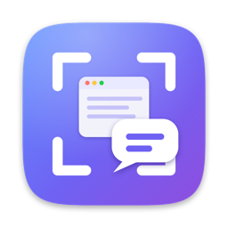
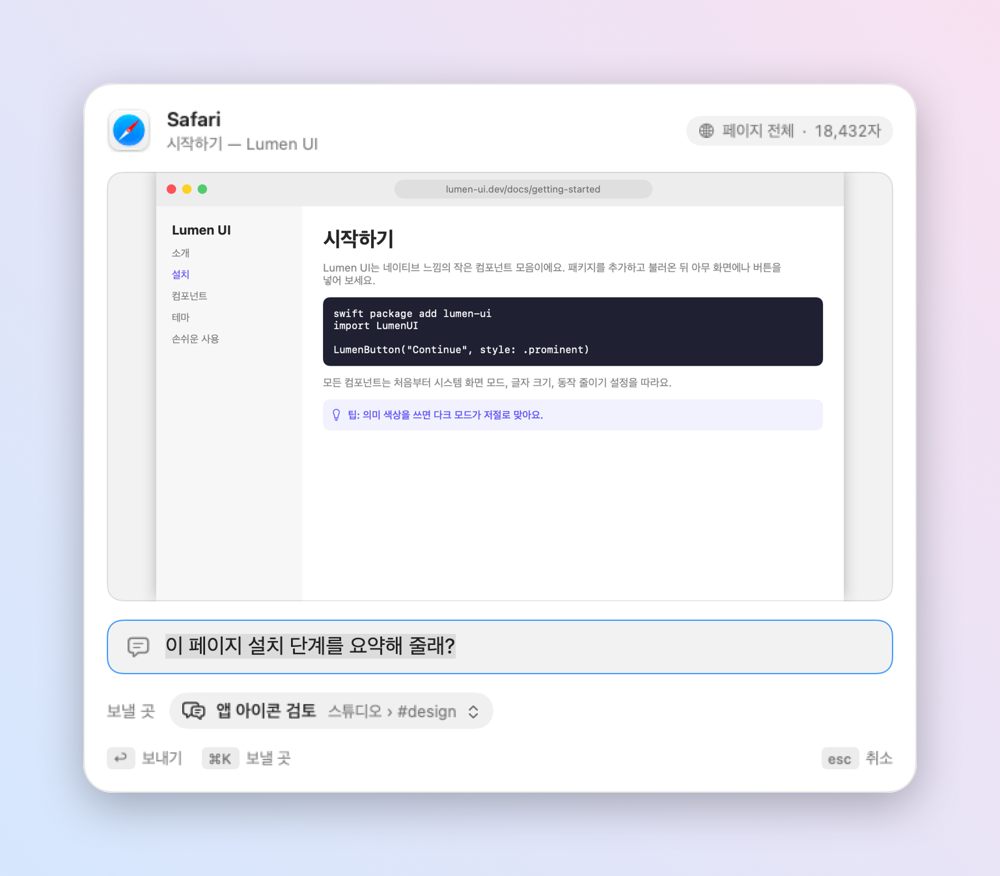
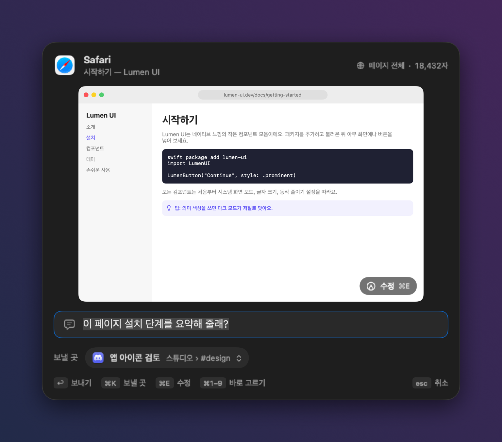
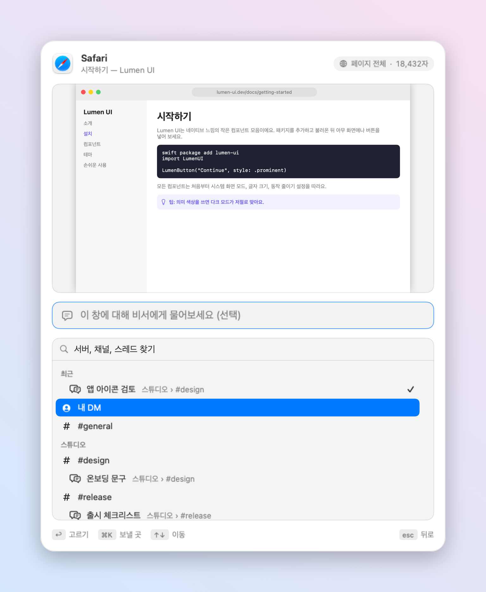
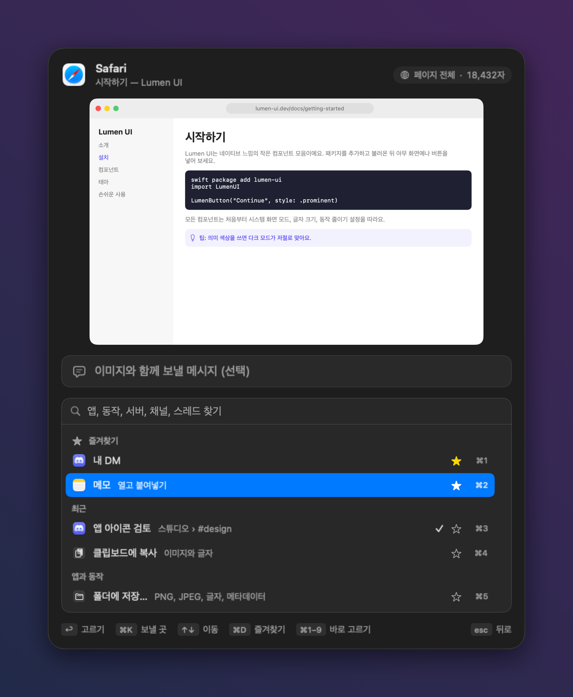
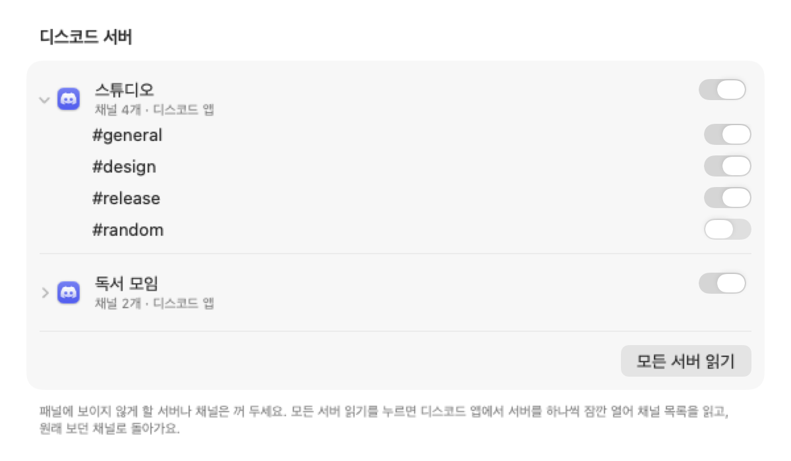
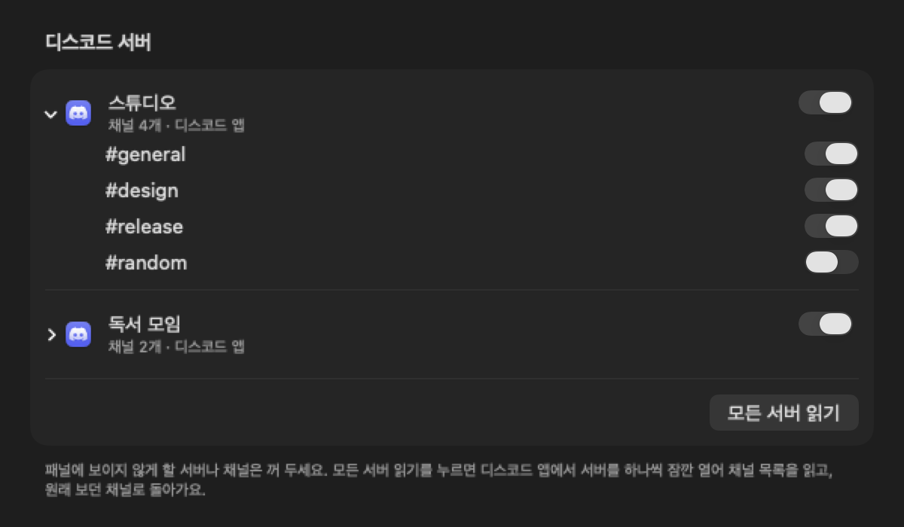
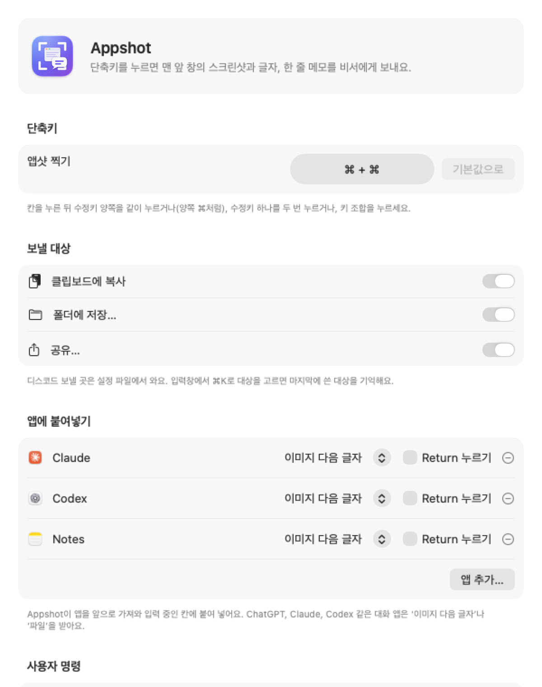
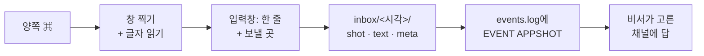

<p align="center">
  
</p>

<h1 align="center">Appshot</h1>

<p align="center">
  <b>양쪽 ⌘를 누르면 지금 보는 창을 비서가 같이 봐요.</b><br>
  맨 앞 창의 스크린샷과 창 전체 글자를 찍어 내가 쓴 한 줄과 함께 비서, 클립보드, 폴더, 다른 앱 어디로든 보내는 맥 메뉴 막대 앱이에요.
</p>

<p align="center"><i>Codex의 Appshots에서 영감을 받았어요.</i></p>

<p align="center">
  <a href="README.md">English</a> ·
  <a href="https://github.com/floweredao/appshot/releases/latest">내려받기</a> ·
  MIT 라이선스
</p>

<p align="center"></p>
<p align="center"></p>


## 기능

- **단축키 하나.** 양쪽 ⌘를 같이 누르면(녹화한 다른 단축키도 돼요) 쓰던 창 위에 입력창이 떠요.
- **크고 정확한 미리보기.** ScreenCaptureKit으로 그림자 없이 원본 해상도로 찍고, 창 비율 그대로 보여 줘요.
- **보이는 부분이 아니라 페이지 전체.** 사파리·크롬 계열 브라우저에서는 페이지 전체 글, 주소, 선택한 글을 읽어요. 다른 앱은 손쉬운 사용 트리를 끝까지 따라가서 스크롤 밖 글자까지 모아요. 둘 다 안 되면 스크린샷을 맥 안에서 OCR로 읽어요. 자세한 내용은 [무엇을 어떻게 읽나요](#무엇을-어떻게-읽나요)에 있어요.
- **어디로든 보내기.** 디스코드 비서, 클립보드, 폴더, 공유 메뉴, 사용자 명령, 또는 ChatGPT·Claude·Codex·메모·슬랙에 바로 붙여넣기. [보낼 대상](#보낼-대상)을 보세요.
- **진짜 보낼 곳.** 디스코드 서버·채널·진행 중 스레드를 이름 그대로 고르고 찾을 수 있어요. 최근에 쓴 곳은 맨 위에 와요. DM에도 "내 DM"처럼 알아보기 쉬운 이름을 붙일 수 있어요.
- **키보드로 다 돼요.** ↩ 보내기, ⌘K 보낼 곳 목록, ↑↓ 이동, ⌘D 즐겨찾기, ⌘1~⌘9 바로 고르기, esc 뒤로·취소.
- **영어·한국어.** 맥 시스템 언어를 따라가요.
- **내가 보내지 않으면 맥 밖으로 나가는 것 없음.** Appshot은 내 맥의 폴더에 파일만 쓰고, 비서가 그 폴더를 읽어 가요. 앱 안에 토큰이 없어요. 앱이 직접 하는 네트워크 통신은 GitHub에서 업데이트를 확인하는 것뿐이고, 이것도 끌 수 있어요. 그 밖에는 웹훅이나 붙여 넣을 앱처럼 내가 고른 대상으로만 나가요.

<p align="center"></p>
<p align="center"></p>

## 보낼 대상

입력창에서 ⌘K로 앱샷을 보낼 곳을 골라요. 마지막에 쓴 대상을 기억해요.

| 대상 | 하는 일 |
| --- | --- |
| **비서 (디스코드)** | 비서의 inbox에 폴더를 쓰고 이벤트 로그에 `EVENT APPSHOT`을 덧붙여요. 비서가 고른 서버·채널·스레드·DM에 답해요. |
| **클립보드에 복사** | 스크린샷은 이미지로, 한 줄과 창 글자는 글자로 클립보드에 넣어요. |
| **폴더에 저장…** | 폴더를 물어보고(마지막 폴더 기억) `shot.png`, `shot.jpg`, `text.md`, `meta.json`을 복사해요. |
| **앱에 붙여넣기** | 추가해 둔 앱(ChatGPT, Claude, Codex, 메모, 슬랙 등)을 앞으로 가져와 입력 중인 칸에 붙여 넣어요. 앱마다 *이미지 다음 글자*, *파일 (PNG + text.md)*, *글자만*, *이미지만* 가운데 고르고, 붙인 뒤 Return을 누를지도 정할 수 있어요. |
| **공유…** | macOS 공유 메뉴(메일, 메시지, AirDrop 등)를 스크린샷과 글자로 열어요. |
| **사용자 명령** | 셸 명령을 돌리거나, URL scheme을 열거나, 웹훅에 JSON을 POST해요. 자리표시자: `{folder}` `{note}` `{app}` `{title}` `{url}` `{screenshot}` `{preview}` `{text}` `{channel}`. 셸에서는 값을 따옴표로 감싸 주고 `APPSHOT_*` 환경 변수도 넣어요. |

클립보드·폴더·공유 대상은 **설정… › 보낼 대상**에서 켜고 끄고, 앱은 **설정… › 앱에 붙여넣기**에서 추가하고, 명령은 **설정… › 사용자 명령**에서 써요. 명령 예: `open -a Preview {screenshot}`

**디스코드 서버와 채널.** 디스코드 앱을 붙여넣기 대상으로 추가하면(설치돼 있으면 **설정… › 디스코드 서버 › 디스코드 추가**), 앱샷이 디스코드 앱에 보이는 채널을 손쉬운 사용으로 읽어 보낼 곳 목록에 서버별로, 디스코드 아이콘과 함께 보여 줘요. 채널을 고르면 디스코드에서 그 채널을 열고 거기에 붙여 넣어요. **모든 서버 읽기**를 누르면 서버 사이드바의 서버를 하나씩 잠깐 열어 채널을 읽고 원래 보던 채널로 돌아와요. 그래서 열려 있던 서버 하나가 아니라 들어가 있는 서버가 모두 나와요. 패널에 안 보이게 할 서버나 채널은 꺼 두면 돼요. 나중에 찾은 서버는 알아서 켜진 채로 나와요. 설정 파일에 비서 봇 목록이 있으면 그 서버도 같은 목록에서 골라요. 디스코드가 없거나, 안 켜져 있거나, 손쉬운 사용 권한이 꺼져 있으면 무엇을 하면 되는지 그 칸에 알려 줘요. 채널 목록은 `~/Library/Application Support/Appshot/app-channels.json`에 저장돼요.

<p align="center"></p>
<p align="center"></p>

### 즐겨찾기와 숫자 단축키

- 보낼 곳 목록에서 항목 옆의 별을 누르면(또는 강조된 줄에서 **⌘D**) 고정돼요. 즐겨찾기는 "최근"보다 위, 맨 위 칸에 와요.
- 순서 바꾸기와 빼기는 **설정… › 즐겨찾기**에서 해요.
- **숫자 단축키**가 켜져 있으면(기본값) **⌘1~⌘9**로 목록 위에서부터 그 순서의 보낼 곳을 바로 골라요. 목록을 열지 않아도 돼요. 숫자는 각 줄 옆에 보여요. 다른 단축키와 겹치면 설정에서 끌 수 있어요.

## 설치

Appshot은 macOS 15 이상이 필요해요.

1. [최신 릴리스](https://github.com/floweredao/appshot/releases/latest)에서 `Appshot.zip`을 받아 풀고 **Appshot.app**을 `/Applications`로 옮겨요.
2. 앱을 열어요. 릴리스는 Apple Development 인증서로 서명했지만 공증(notarization)은 받지 않았어요. 그래서 처음 열 때는 앱을 Control-클릭한 뒤 **열기**를 눌러야 해요. 직접 빌드하려면 [소스로 빌드](#소스로-빌드)를 보세요.
3. 앱을 열면 "로그인할 때 열기"가 켜지고 설정 창이 떠요.

### 권한 두 개 켜기

| 권한 | 쓰는 곳 | 켜는 곳 |
| --- | --- | --- |
| **화면 기록** | 창 스크린샷 | 시스템 설정 › 개인정보 보호 및 보안 › 화면 및 시스템 오디오 기록 |
| **손쉬운 사용** | 창 글자 읽기, 단축키 듣기 | 시스템 설정 › 개인정보 보호 및 보안 › 손쉬운 사용 |

설정 창에서 각 항목 옆의 **허용…**을 누르고, 시스템 설정에서 Appshot을 켠 뒤 **다시 시작**을 눌러요.

웹페이지 전체를 담으려면 두 가지가 더 필요해요.

- macOS가 "Appshot이 브라우저를 제어하도록 허용할까요?"라고 물으면 **허용**을 눌러요(자동화 권한).
- 브라우저에서 'Apple Events의 JavaScript 허용'을 켜요. 사파리는 **개발자 › Apple Events의 JavaScript 허용**, 크롬은 **보기 › 개발자 › Apple Events의 JavaScript 허용**이에요.

이걸 켜지 않아도 Appshot은 손쉬운 사용으로 페이지를 읽어요.

<p align="center"></p>

### 업데이트

Appshot은 하루에 한 번, 그리고 메뉴 막대 메뉴에서 **업데이트 확인…**을 누를 때 [최신 GitHub 릴리스](https://github.com/floweredao/appshot/releases/latest)를 확인해요. 새 버전이 있으면 **설치하고 다시 시작**을 누르면 돼요. 자동 확인은 **설정… › 업데이트**에서 끌 수 있어요.

자기 자신을 바꾸기 전에 받은 파일을 확인하고, 하나라도 맞지 않으면 설치하지 않고 이유를 보여 줘요.

- `api.github.com/repos/floweredao/appshot`에만 묻고, 이 저장소의 릴리스 파일만 HTTPS로 받아요.
- zip의 SHA-256이 GitHub가 릴리스 파일에 붙여 둔 체크섬과 같아야 해요.
- 안에 든 앱의 번들 ID, 개발자 팀, 서명 인증서가 지금 앱과 같고, 버전이 더 높아야 해요.

Appshot은 `/Applications`처럼 쓰기 권한이 있는 폴더에 두세요. 0.3.2 이하에서 올라올 때는 한 번만 직접 받아 주세요.

## 단축키

기본값은 **양쪽 ⌘를 같이 누르기**예요. 바꾸려면 메뉴 막대 아이콘에서 **설정…**을 열고 단축키 칸을 누른 뒤, 아래 가운데 하나를 해요.

- 수정키 하나의 양쪽을 같이 누르기 (예: 양쪽 ⌥)
- 수정키 하나를 빠르게 두 번 누르기 (예: ⌃ ⌃)
- ⌘, ⌥, ⌃ 중 하나가 들어간 키 조합 누르기 (예: ⌥⌘A)

macOS가 보통 쓰는 조합(예: Spotlight의 ⌘Space)이나 다른 앱이 이미 쓰는 조합이면 경고해요. **기본값으로**를 누르면 ⌘ + ⌘로 돌아가요. 고른 값은 저장돼서 다시 시작해도 유지돼요.

## 동작 방식



앱샷 하나가 폴더 하나예요.

```
<inboxDir>/<yyyyMMdd-HHmmss-SSS>/
  shot.png    원본 해상도 창 스크린샷
  shot.jpg    미리보기 (긴 변 1568px)
  text.md     창 글자 Markdown (선택한 글 먼저, 그다음 페이지)
  meta.json   앱·창·주소·한 줄·보낼 곳·글자 얻은 방법·오류
```

다른 대상(클립보드, 폴더, 공유, 앱, 명령)으로 보낸 앱샷도 같은 모양으로 `~/Library/Application Support/Appshot/Captures`에 남고, 최근 50개만 유지돼요.

폴더는 임시 폴더에 먼저 만들어요. 그 안의 파일도 하나씩 `.tmp`로 쓴 뒤 이름을 바꿔요. 폴더를 제자리로 옮긴 다음에야 이벤트 로그에 `EVENT APPSHOT <폴더>`를 써요. 그래서 비서가 덜 쓴 폴더를 읽는 일이 없어요.

## 무엇을 어떻게 읽나요

가장 많이 읽히는 방법을 먼저 쓰고, 안 되면 다음 방법으로 내려가요. 어떤 방법을 썼는지는 `meta.json`의 `text.method`와 `text.attempts`에 적어요.

| 앱 | 1순위 | 2순위 | 3순위 |
| --- | --- | --- | --- |
| 사파리, 크롬, Arc, Brave, Edge, Vivaldi, Opera | 페이지 스크립트: `document.body.innerText`, 주소, 선택한 글 | 손쉬운 사용 트리 (크롬 계열엔 전체 트리를 보여 달라고 요청) | OCR |
| 터미널, iTerm2 | AppleScript로 스크롤 기록 | 손쉬운 사용 | OCR |
| 그 밖의 앱 (Firefox, 메일, 메모, Xcode, 슬랙, 디스코드, Ghostty…) | 손쉬운 사용 트리, 화면 밖 항목까지 전부 | OCR | |

Ghostty처럼 글자를 직접 그리는 터미널은 손쉬운 사용으로 지금 보이는 화면만 내어 줘서, 그 위로 스크롤된 기록은 들어가지 않아요. 앱샷 설정 창도 앞에 둔 채 단축키를 누르면 찍혀요.

글자는 20만 자까지 담아요. 아주 긴 페이지는 앞과 뒤를 남기고, 가운데를 얼마나 뺐는지 적어 둬요. 비밀번호 칸은 읽지 않아요. 글자를 그림으로만 그리는 앱(예: 캔버스를 쓰는 Google Docs)은 OCR로 보이는 부분만 읽을 수 있어요.

Codex는 이렇게 해요. OpenAI 문서에 따르면 Appshots는 손쉬운 사용으로 "앱이 주는 글자"를 읽어요. 앱이 주면 스크롤 밖 글자도 포함하고, 이미지는 따로 찍어요. 브라우저 페이지 스크립트는 Appshot이 더한 방법이에요. 브라우저의 손쉬운 사용 트리가 일부만 나올 때도 페이지 전체가 들어오게 하려는 거예요.

## 설정 파일

내 컴퓨터만의 값은 저장소에 넣지 않아요. Appshot은 `~/Library/Application Support/Appshot/config.json`을 읽어요. **설정… › 설정 파일**에서 **템플릿 만들기**를 누르면 아래 예시를 그 자리에 만들어 줘요.

```json
{
  "stateDir": "~/path/to/assistant/state",
  "inboxDir": "~/path/to/assistant/inbox/appshot",
  "channels": [
    { "key": "dm", "label": "내 DM", "id": "DM_CHANNEL_ID", "kind": "direct" },
    { "key": "general", "label": "#general", "id": "GENERAL_CHANNEL_ID", "kind": "channel" }
  ],
  "fallbackChannel": "general",
  "catalog": { "cli": "/path/to/agent-discordbot", "bot": "BOT_ALIAS", "refreshMinutes": 15 }
}
```

- `stateDir`: `events.log`, `owner-inbox.jsonl`, `handled-ids.txt`가 있는 폴더예요. 각 파일은 `eventsLog`, `ownerInbox`, `handledIds`로 따로 정할 수 있어요(절대 경로, 또는 `stateDir` 기준 상대 경로).
- `inboxDir`: 앱샷 폴더를 만드는 곳이에요. `~/Documents`, `~/Desktop`, `~/Downloads` 밖에 두세요. 안에 두면 macOS가 폴더 접근을 물어요.
- `channels`: 꼭 있어야 해요. 목록 맨 위에 고정할 곳이에요(예: 내 DM). 항목마다 `key`와 `id`가 필요하고, `kind`는 `direct`(기본값), `channel`, `thread` 가운데 하나예요.
- `catalog`: 선택 항목이에요. 이 CLI(`server list`, `channel list`, `thread list`, `bot`이 있으면 `--bot <bot>`도 붙여서)를 `refreshMinutes`분(기본값 15)마다 돌려 서버·채널·진행 중 스레드를 `~/Library/Caches/Appshot/discord-catalog.json`에, `path`를 정했으면 그 파일에 담아 둬요. 봇 토큰은 그 CLI 안에만 있어요.
- `fallbackChannel`: 꼭 있어야 해요. `channels`에 있는 `key` 하나로, 최근 대화를 못 찾을 때 쓸 곳이에요.

처음 골라져 있는 곳은 비서가 마지막으로 처리한 메시지의 채널이에요. `handled-ids.txt`의 마지막 ID로 `owner-inbox.jsonl`에서 그 메시지를 찾아요. 그 ID가 없으면 `owner-inbox.jsonl`의 마지막 줄 채널을, 둘 다 없으면 `fallbackChannel`을 써요. 마지막으로 보낸 곳이 비서가 아니었다면(예: 클립보드나 앱) 그곳이 대신 골라져 있어요.

## 개인 정보

- **저장하는 것:** 스크린샷, 창 글자, 내가 쓴 한 줄, 메타데이터. 모두 내 맥에만 남아요. 비서로 보낸 것은 `inboxDir`에, 다른 대상으로 보낸 것은 `~/Library/Application Support/Appshot/Captures`(최근 50개)에 있어요. 디스코드 보낼 곳 목록(`~/Library/Caches/Appshot`), 디스코드 앱에서 읽은 채널(`app-channels.json`), 최근 보낸 곳·즐겨찾기·보낼 대상·단축키(앱 환경설정)도 내 맥에만 저장돼요.
- **보내는 것:** Appshot이 비서 채팅에 직접 보내는 것은 없어요. 폴더를 읽은 비서가 무엇을 올릴지 정해요. 다른 대상은 내가 보낸 것을 받아요(붙여 넣은 앱, 공유 서비스, 웹훅). Appshot이 직접 하는 네트워크 통신은 GitHub에서 업데이트를 확인하고 받는 것뿐이에요([업데이트](#업데이트) 참고).
- **읽지 않는 것:** 비밀번호 칸.
- **저장소 관리:** 푸시하기 전마다 `scripts/prepush-check.sh`가 gitleaks를 돌리고 이메일, 홈 경로, 디스코드 ID 모양 숫자, 엉뚱한 그림 파일, 개인 문자열을 찾아요.

## 소스로 빌드

Xcode 16 이상(Swift 6, macOS 15 SDK), XcodeGen, Apple Development 서명 인증서가 필요해요.

```sh
brew install xcodegen
echo 'DEVELOPMENT_TEAM = <팀 ID>' > Config/Local.xcconfig   # git에 안 들어가요
./scripts/build.sh --install                                # -> /Applications/Appshot.app
swift test --package-path Packages/AppshotCore              # 단위 테스트
```

늘 같은 인증서로 서명해야 업데이트한 뒤에도 권한이 유지돼요.

스크립트로 실행하기:

```sh
open -n -W -a Appshot --stdout out.txt --args --appshot-now --note "이거 뭐야?" --channel recent
```

입력창 없이 맨 앞 창을 찍고 `<보낼 곳>에 보냄 · <폴더 이름>` 같은 결과 한 줄을 출력해요. `--channel`에는 `recent`(기본값), `channels`의 `key`, 보낼 곳 ID, 또는 `clipboard` 같은 대상을 줄 수 있어요. `--app <번들 ID>`는 그 앱의 맨 앞 창을 찍고, `--delay-ms`는 찍기 전에 기다릴 시간(기본값 500)이고, `--config <경로>`는 다른 설정 파일을 읽어요. 종료 코드는 2 설정 오류, 3 창 없음, 4 모르는 채널, 5 보내기·저장 실패예요.

## 라이선스

MIT. [LICENSE](LICENSE)를 보세요.
