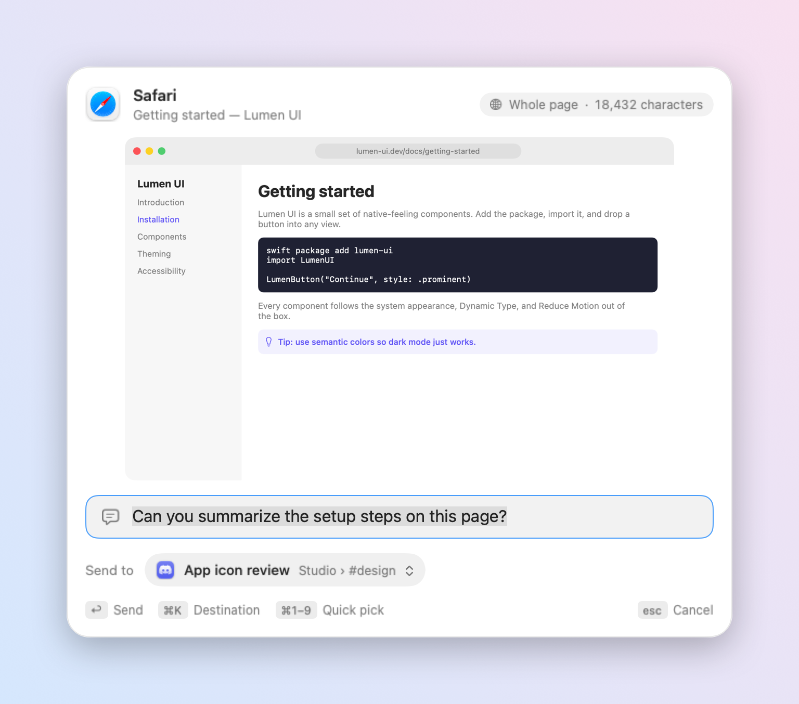
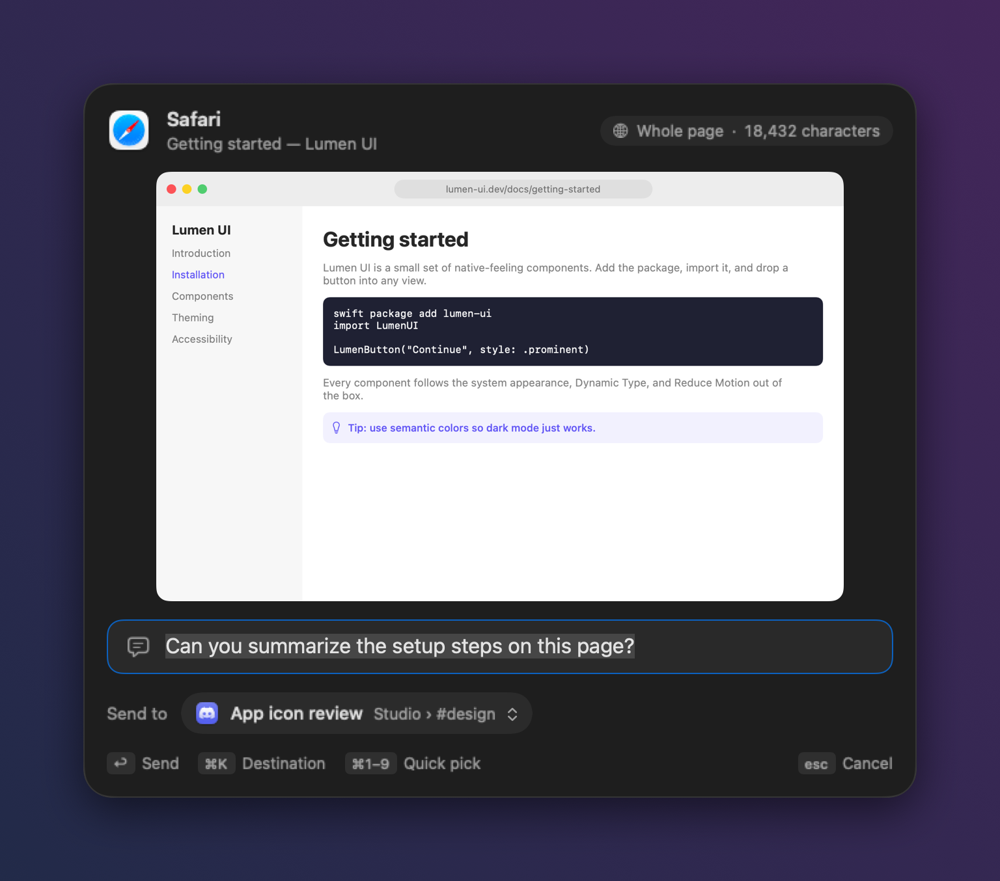
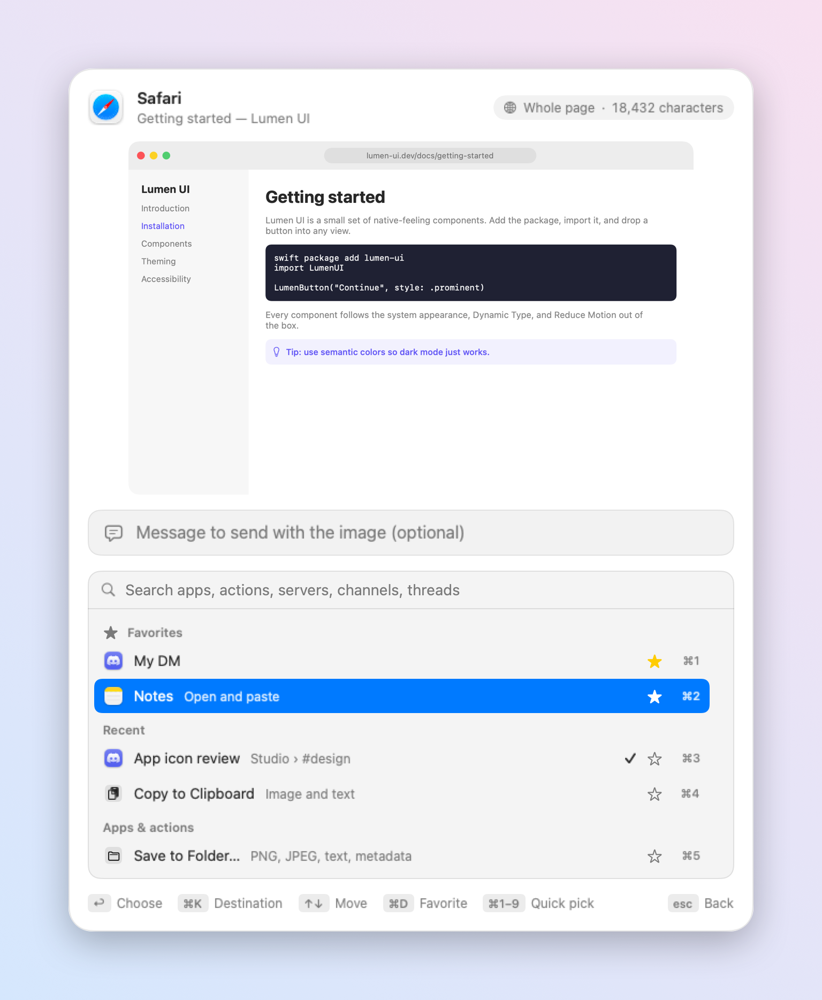
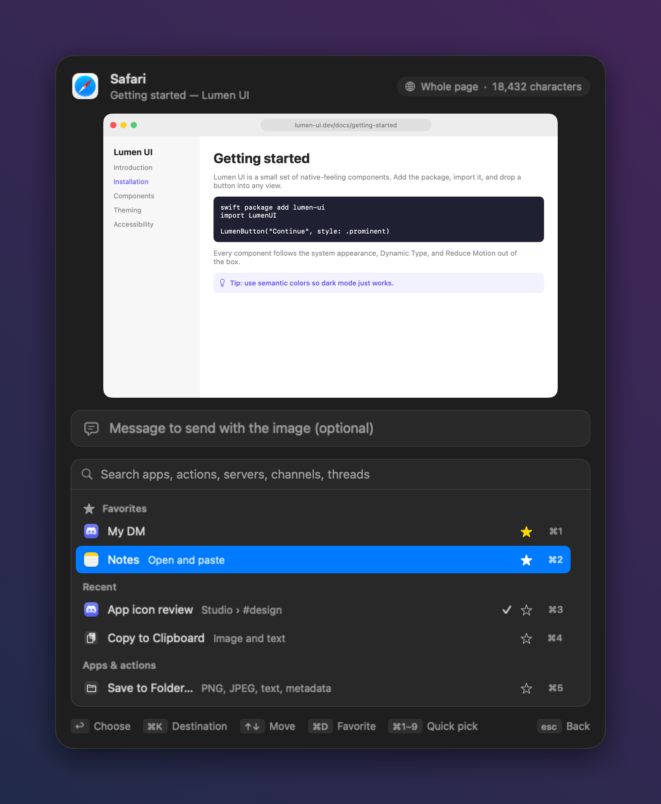
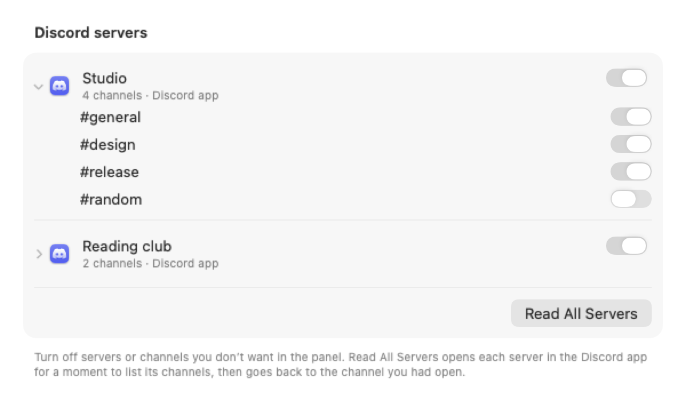
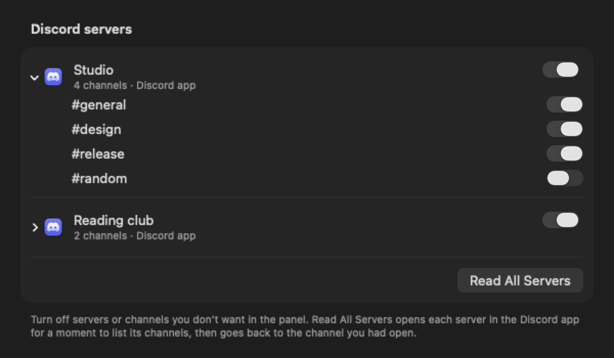
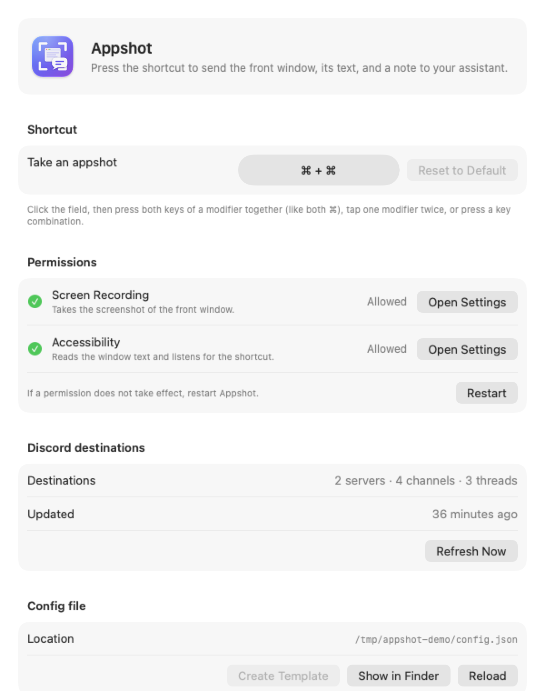
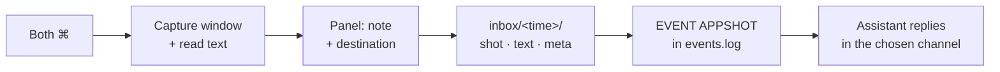

<p align="center">
  
</p>

<h1 align="center">Appshot</h1>

<p align="center">
  <b>Press both ⌘ keys. Your assistant sees the window you are looking at.</b><br>
  A macOS menu bar app that captures the front window's screenshot and full text, then sends it with one line from you to your assistant, the clipboard, a folder, or any app.
</p>

<p align="center"><i>Inspired by Codex Appshots.</i></p>

<p align="center">
  <a href="README-ko.md">한국어</a> ·
  <a href="https://github.com/floweredao/appshot/releases/latest">Download</a> ·
  MIT License
</p>

<p align="center"></p>
<p align="center"></p>


## Features

- **One shortcut.** Press both Command keys together (or any shortcut you record) and a floating panel appears over the window you were using.
- **A large, accurate preview.** The window is captured with ScreenCaptureKit at full resolution, without its shadow, and shown at its real aspect ratio.
- **The whole page, not just the pixels.** In Safari and Chromium browsers, Appshot reads the entire page text, its URL, and your selection. In other apps, it walks the Accessibility tree, which includes text scrolled out of view. When neither works, it falls back to on-device OCR of the screenshot. See [What Appshot reads](#what-appshot-reads).
- **Send it anywhere.** Your Discord assistant, the clipboard, a folder, the Share menu, a custom command, or straight into ChatGPT, Claude, Codex, Notes, or Slack. See [Send targets](#send-targets).
- **Real destinations.** Pick a Discord server, channel, or active thread by name, search it, and keep your recent choices at the top. Your DM can carry its own name, like "My DM".
- **Keyboard first.** ↩ sends, ⌘K opens the destination list, ↑↓ moves, ⌘D stars a favorite, ⌘1–⌘9 picks quickly, and esc goes back or cancels.
- **English and Korean.** The app follows your macOS language.
- **Nothing leaves your Mac.** Appshot writes files to a local folder. Your assistant picks them up from there. The app holds no tokens and makes no network calls of its own.

<p align="center"></p>
<p align="center"></p>

## Send targets

Pick where an appshot goes in the panel with ⌘K. Appshot remembers the last target you used.

| Target | What happens |
| --- | --- |
| **Assistant (Discord)** | Writes the folder to your assistant's inbox and appends `EVENT APPSHOT` to its events log. The assistant replies in the server, channel, thread, or DM you picked. |
| **Copy to Clipboard** | Puts the screenshot (as an image) and the note plus window text (as text) on the clipboard. |
| **Save to Folder…** | Asks for a folder (remembering the last one) and copies `shot.png`, `shot.jpg`, `text.md`, and `meta.json` there. |
| **Paste into an app** | Brings an app you added (ChatGPT, Claude, Codex, Notes, Slack, …) to the front and pastes into its focused text field. Per app, choose *Image, then text*, *Files (PNG + text.md)*, *Text only*, or *Image only*, and optionally press Return. |
| **Share…** | Opens the macOS Share menu (Mail, Messages, AirDrop, …) with the screenshot and text. |
| **Custom command** | Runs a shell command, opens a URL scheme, or POSTs JSON to a webhook. Placeholders: `{folder}` `{note}` `{app}` `{title}` `{url}` `{screenshot}` `{preview}` `{text}` `{channel}`. Shell values are quoted, and `APPSHOT_*` environment variables are set. |

**Discord servers and channels.** When you add the Discord app as a paste target (**Settings… › Discord servers › Add Discord** if it's installed), Appshot reads the channels the Discord app shows through Accessibility and lists them in the picker, grouped by server, with the Discord icon. Choosing one opens that channel in Discord and pastes there. **Read All Servers** opens each server in your server sidebar for a moment, reads its channels, and returns to the channel you had open, so every server you belong to shows up, not just the one that was open. Turn whole servers or single channels off to keep them out of the panel; servers found later show up on their own. The same list covers your assistant bot's servers when the config file has a catalog. If Discord isn't installed, isn't running, or Accessibility is off, the section says what to do. Channels are kept in `~/Library/Application Support/Appshot/app-channels.json`.

<p align="center"></p>
<p align="center"></p>

Turn targets on or off, add apps, and write commands in **Settings… › Send targets**. Example command: `open -a Preview {screenshot}`.

### Favorites and number shortcuts

- Click the star next to any destination in the picker (or press **⌘D** on the highlighted row) to pin it. Favorites sit at the very top, above Recent.
- Reorder or remove favorites in **Settings… › Favorites**.
- With **Number shortcuts** on (the default), **⌘1–⌘9** picks the destination at that position, counting from the top of the list, whether or not the picker is open. The number appears next to each row. Turn it off in Settings if those keys clash with something you use.

## Install

1. Download `Appshot.zip` from the [latest release](https://github.com/floweredao/appshot/releases/latest), unzip it, and move **Appshot.app** to `/Applications`.
2. Open it. The release is signed with an Apple Development certificate and is not notarized, so the first launch needs a Control-click on the app, then **Open**. To build it yourself instead, see [Build from source](#build-from-source).
3. Appshot turns on "Open at login" and shows its settings window.

### Turn on the two permissions

| Permission | Why | Where |
| --- | --- | --- |
| **Screen Recording** | Takes the window screenshot. | System Settings › Privacy & Security › Screen & System Audio Recording |
| **Accessibility** | Reads window text and listens for the shortcut. | System Settings › Privacy & Security › Accessibility |

Click **Allow…** next to each item in the settings window, switch Appshot on in System Settings, then click **Restart**.

To include whole web pages, also allow **Automation** when macOS asks whether Appshot may control your browser. Safari additionally needs **Develop › Allow JavaScript from Apple Events**. In Chrome, use **View › Developer › Allow JavaScript from Apple Events**. Without these, Appshot still works: it reads the page through Accessibility instead.

<p align="center"></p>

### Updates

Appshot checks the [latest GitHub release](https://github.com/floweredao/appshot/releases/latest) once a day and when you choose **Check for Updates…** in the menu bar menu. When a newer version is out, click **Install and Restart**. Turn automatic checks off in **Settings… › Updates**.

Before it replaces itself, Appshot checks the download and installs nothing if any check fails, showing the reason instead:

- It talks only to `api.github.com/repos/floweredao/appshot` and downloads only this repository's release assets, over HTTPS.
- The zip's SHA-256 must match the checksum GitHub publishes for the release asset.
- The app inside must have the same bundle ID, the same developer team, and the same signing certificate as the copy you are running, and a higher version.

Keep Appshot in a folder you can write to, such as `/Applications`. Updating from 0.3.2 or earlier is a one-time manual download.

## Shortcut

The default is **both ⌘ keys pressed together**. To change it, open **Settings…** from the menu bar icon and click the shortcut field. Then do one of these:

- press both keys of one modifier together, such as both ⌥;
- tap one modifier twice quickly, such as ⌃ ⌃;
- press a key combination that includes ⌘, ⌥, or ⌃, such as ⌥⌘A.

Appshot warns you when a combination is normally used by macOS (for example ⌘Space for Spotlight) or is already taken by another app. **Reset to Default** brings back ⌘ + ⌘. Your choice is saved and kept across restarts.

## How it works



Each appshot is one folder:

```
<inboxDir>/<yyyyMMdd-HHmmss-SSS>/
  shot.png    full-resolution window capture
  shot.jpg    preview, long edge 1568 px
  text.md     window text as Markdown (selection first, then the page)
  meta.json   app, window, URL, your note, destination, text method, errors
```

Appshot builds the folder in a staging directory, renaming each file from `.tmp`, and then renames the folder into place. Only after that does it append `EVENT APPSHOT <folder>` to the events log, so the assistant never sees a half-written folder.

## What Appshot reads

Appshot tries the method that returns the most text first, falls back to the next one when that fails, and records the method it used in `meta.json` (`text.method` and `text.attempts`).

| App | 1st | 2nd | 3rd |
| --- | --- | --- | --- |
| Safari, Chrome, Arc, Brave, Edge | Page script: `document.body.innerText`, URL, selection | Accessibility tree (Chromium is asked to expose its full tree) | OCR |
| Terminal, iTerm2 | Scrollback through AppleScript | Accessibility | OCR |
| Everything else (Mail, Notes, Xcode, Slack, Discord, Ghostty…) | Accessibility tree, all children including off-screen ones | OCR | |

Terminals that draw their own text, such as Ghostty, expose only the screen that is currently visible through Accessibility, so the scrollback above it is not included. Appshot's own Settings window can be captured too: press the shortcut while it is in front.

Text is capped at 200,000 characters. Very long pages keep their beginning and end, with a note saying how much was left out. Password fields are never read. Some apps only draw text as pixels (for example, Google Docs uses a canvas). For those apps, only the visible part is available, through OCR.

How Codex does it: OpenAI documents that Appshots reads "available text" through Accessibility, including text outside the visible area when the app exposes it, and takes the image separately. The browser page script is Appshot's addition, so that a whole web page arrives even when the browser's accessibility tree is partial.

## Configuration

Machine-specific values never live in the repository. Appshot reads `~/Library/Application Support/Appshot/config.json`:

```json
{
  "stateDir": "~/path/to/assistant/state",
  "inboxDir": "~/path/to/assistant/inbox/appshot",
  "channels": [
    { "key": "dm", "label": "My DM", "id": "DM_CHANNEL_ID", "kind": "direct" },
    { "key": "general", "label": "#general", "id": "GENERAL_CHANNEL_ID", "kind": "channel" }
  ],
  "fallbackChannel": "general",
  "catalog": { "cli": "/path/to/agent-discordbot", "bot": "BOT_ALIAS", "refreshMinutes": 15 }
}
```

| Key | Meaning |
| --- | --- |
| `stateDir` | Folder with `events.log`, `owner-inbox.jsonl`, and `handled-ids.txt`. Each can be overridden with `eventsLog`, `ownerInbox`, or `handledIds`. |
| `inboxDir` | Where appshot folders are created. Keep it out of `~/Documents`, `~/Desktop`, and `~/Downloads`, or macOS asks for folder access. |
| `channels` | Destinations pinned at the top of the picker, such as your DM. |
| `catalog` | Optional. Appshot runs this CLI (`server list`, `channel list`, `thread list`) every `refreshMinutes` minutes and caches servers, channels, and active threads in `~/Library/Caches/Appshot/discord-catalog.json`. The bot token stays inside that CLI. |
| `fallbackChannel` | Used when no recent conversation can be found. |

The preselected destination is the channel of the last message your assistant handled: the last ID in `handled-ids.txt`, looked up in `owner-inbox.jsonl`. If that ID isn't found, Appshot uses the last line of `owner-inbox.jsonl`, and if neither exists, `fallbackChannel`.

## Privacy

- **What is saved:** the screenshot, the window text, your note, and metadata, all in `inboxDir` on your Mac. Also stored locally: the Discord destination list (`~/Library/Caches/Appshot`) and your recent destinations and shortcut (app preferences).
- **What is sent:** nothing, by Appshot itself. Your assistant decides what to post after reading the folder.
- **What is never read:** password fields.
- **Repository hygiene:** `scripts/prepush-check.sh` runs gitleaks and scans for emails, home paths, Discord-style IDs, stray images, and personal strings before every push.

## Build from source

```sh
brew install xcodegen
echo 'DEVELOPMENT_TEAM = <your team id>' > Config/Local.xcconfig   # git-ignored
./scripts/build.sh --install                                         # -> /Applications/Appshot.app
swift test --package-path Packages/AppshotCore                       # unit tests
```

Signing with the same certificate every time keeps the permissions across updates.

Scripting:

```sh
open -n -W -a Appshot --stdout out.txt --args --appshot-now --note "what is this?" --channel recent
```

This captures the front window without showing the panel and prints the folder path. Exit codes: 2 config error, 3 no window, 4 unknown channel, 5 write failure.

## License

MIT. See [LICENSE](LICENSE).
