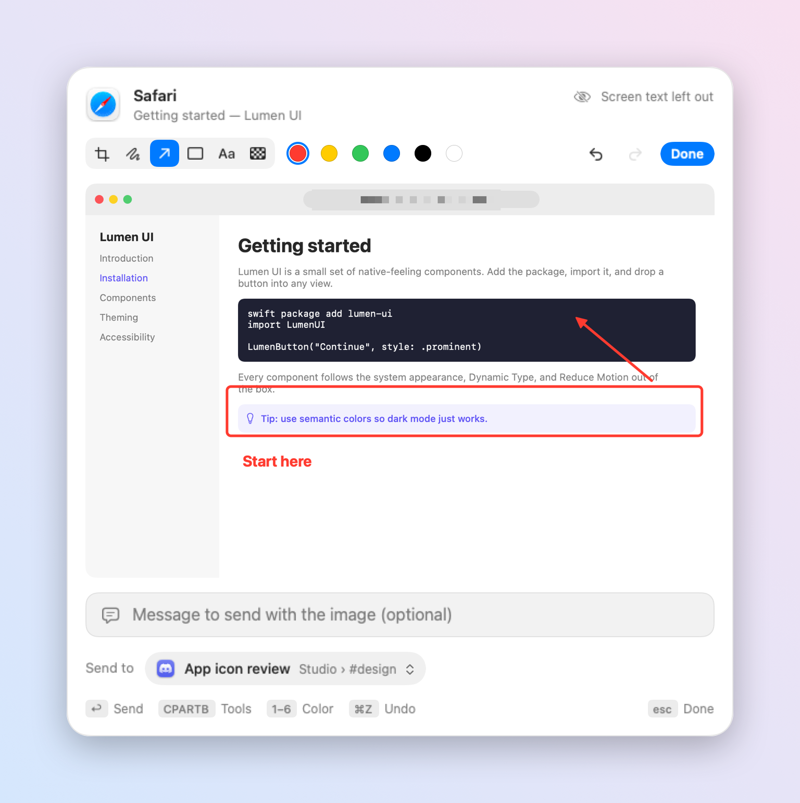
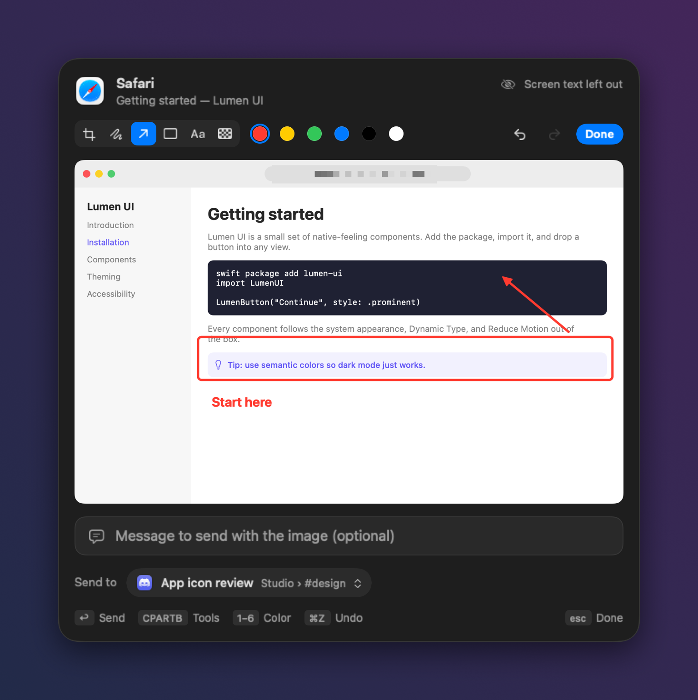
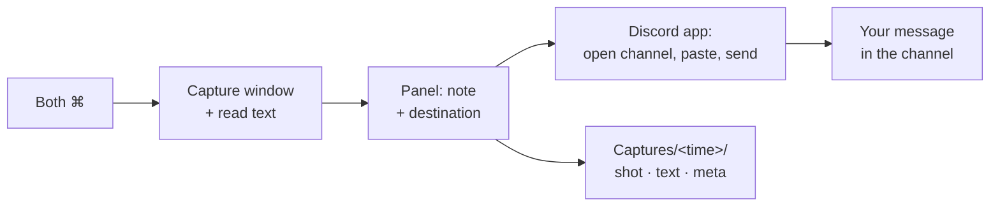

<p align="center">
  
</p>

<h1 align="center">Appshot</h1>

<p align="center">
  <b>Press both ⌘ keys. Your assistant sees the window you are looking at.</b><br>
  A macOS menu bar app that captures the front window's screenshot and full text, then sends it with one line from you to your assistant, the clipboard, a folder, or any app.
</p>

<p align="center"><i>Inspired by Codex Appshots.</i></p>

<p align="center">
  <a href="README-ko.md">한국어</a> ·
  <a href="https://github.com/floweredao/appshot/releases/latest">Download</a> ·
  MIT License
</p>

<p align="center"></p>
<p align="center"></p>


## Features

- **One shortcut.** Press both Command keys together (or any shortcut you record) and a floating panel appears over the window you were using.
- **A large, accurate preview.** The window is captured with ScreenCaptureKit at full resolution, without its shadow, and shown at its real aspect ratio.
- **The whole page, not just the pixels.** In Safari and Chromium browsers, Appshot reads the entire page text, its URL, and your selection. In other apps, it walks the Accessibility tree, which includes text scrolled out of view. When neither works, it falls back to on-device OCR of the screenshot. See [What Appshot reads](#what-appshot-reads).
- **Send it anywhere.** Your Discord assistant, the clipboard, a folder, the Share menu, a custom command, or straight into ChatGPT, Claude, Codex, Notes, or Slack. See [Send targets](#send-targets).
- **Crop and mark up before you send.** Press ⌘E or click **Edit** on the preview to crop it or add arrows, boxes, pen strokes, text, and pixelation right in the panel, then press ↩ to send the edited image. If you skip it, nothing changes. See [Editing a capture](#editing-a-capture).
- **Real destinations.** Pick a Discord server, channel, or active thread by name, search it, and keep your recent choices at the top. Your DM can carry its own name, like "My DM".
- **Keyboard first.** ↩ sends, ⌘K opens the destination list, ⌘E edits the screenshot, ↑↓ moves, ⌘D stars a favorite, ⌘1–⌘9 picks quickly, and esc goes back or cancels.
- **English and Korean.** The app follows your macOS language.
- **Your channel sees what you sent.** Sending to a Discord channel posts the screenshot and your note there from your own account, through the Discord app, so an assistant bot in that channel can reply to the message. The app holds no tokens. Its only network traffic of its own is the update check against GitHub, which you can turn off; anything else goes out only through a target you pick, such as Discord, a webhook, or an app you paste into.

<p align="center"></p>
<p align="center"></p>

## Editing a capture

Press **⌘E** (or click **Edit** on the preview) and the preview becomes an editor in the same panel. Everything works from the keyboard:

| Key | Tool or action |
| --- | --- |
| C | Crop. Drag a new area, drag the handles, or drag inside to move it. Hold ⇧ to keep the ratio. ↩ applies the crop, esc puts the previous one back. |
| P · A · R | Pen, arrow (⇧ snaps to 45°), rectangle (⇧ makes a square) |
| T | Text. Click where it goes, type, then ↩. |
| B | Pixelate an area. When part of the image is pixelated, Appshot leaves the window text out and sends only the image and your note. |
| 1–6 | Red, yellow, green, blue, black, white |
| ⌘Z · ⇧⌘Z | Undo · redo |
| ↩ | Send the edited image |
| esc · ⌘E | Leave the editor and keep the edits |

The full-resolution screenshot is edited, not the preview, so the image you send stays sharp.

<p align="center"></p>
<p align="center"></p>

## Send targets

Pick where an appshot goes in the panel with ⌘K. Appshot remembers the last target you used.

| Target | What happens |
| --- | --- |
| **Discord channel, thread, or DM** | Opens the place you picked in the Discord app, puts the screenshot and your note into its message box, and sends them as your message. Appshot checks every step through Accessibility: it closes an image viewer or dialog that covers the channel, refuses to touch a message box that already holds an unsent message, and waits until the message box is empty again. When your assistant's bot can read the channel, Appshot also looks the message up and records its ID in the local `meta.json` (`discord.message`). The visible message is the only delivery; nothing is written into the assistant's files. If the message did not go out, the panel comes back with the reason, and `meta.json` lists it under `errors`. |
| **Copy to Clipboard** | Puts the screenshot (as an image) and the note plus window text (as text) on the clipboard. |
| **Save to Folder…** | Asks for a folder (remembering the last one) and copies `shot.png`, `shot.jpg`, `text.md`, and `meta.json` there. |
| **Paste into an app** | Brings an app you added (ChatGPT, Claude, Codex, Notes, Slack, …) to the front and pastes into its focused text field. Per app, choose *Image, then text*, *Files (PNG + text.md)*, *Text only*, or *Image only*, and optionally press Return. By default Appshot pastes only your note with the screenshot; turn on **Add screen text** to also paste the text it read from the window. |
| **Share…** | Opens the macOS Share menu (Mail, Messages, AirDrop, …) with the screenshot and text. |
| **Custom command** | Runs a shell command, opens a URL scheme, or POSTs JSON to a webhook. Placeholders: `{folder}` `{note}` `{app}` `{title}` `{url}` `{screenshot}` `{preview}` `{text}` `{channel}`. Shell values are quoted, and `APPSHOT_*` environment variables are set. |

**Discord servers and channels.** When you add the Discord app as a paste target (**Settings… › Discord servers › Add Discord** if it's installed), Appshot reads the channels the Discord app shows through Accessibility and lists them in the picker, grouped by server, with the Discord icon. Choosing one opens that channel in Discord and posts there, as above. **Read All Servers** opens each server in your server sidebar for a moment, reads its channels, and returns to the channel you had open, so every server you belong to shows up, not just the one that was open. Turn whole servers or single channels off to keep them out of the panel; servers found later show up on their own. The same list covers your assistant bot's servers when the config file has a catalog. If Discord isn't installed, isn't running, or Accessibility is off, the section says what to do. Channels are kept in `~/Library/Application Support/Appshot/app-channels.json`.

**Long Discord lists.** Each Discord channel appears once, under its server, whether Appshot found it through the Discord app or your assistant's bot; threads sit indented under their channel. Click a server's heading to fold or unfold it. Servers with more than six entries start folded, and Appshot remembers what you open or close. Favorites and recent destinations stay at the top, and typing in the search field looks through every server, folded or not. Your assistant's DM is named after the bot (for example **DM · Helper**) rather than the label in the config file. The **Discord** row under apps (*Open and paste*) brings Discord to the front and pastes into whichever channel is open, like any other app.

<p align="center"></p>
<p align="center"></p>

Turn the clipboard, folder, and Share targets on or off in **Settings… › Send targets**, add apps in **Settings… › Paste into apps**, and write commands in **Settings… › Custom commands**. Example command: `open -a Preview {screenshot}`.

### Favorites and number shortcuts

- Click the star next to any destination in the picker (or press **⌘D** on the highlighted row) to pin it. Favorites sit at the very top, above Recent.
- Reorder or remove favorites in **Settings… › Favorites**.
- With **Number shortcuts** on (the default), **⌘1–⌘9** picks the destination at that position, counting from the top of the list, whether or not the picker is open. The number appears next to each row. Turn it off in Settings if those keys clash with something you use.

## Install

Appshot needs macOS 15 or later.

1. Download `Appshot.zip` from the [latest release](https://github.com/floweredao/appshot/releases/latest), unzip it, and move **Appshot.app** to `/Applications`.
2. Open it. The release is signed with an Apple Development certificate and is not notarized, so the first launch needs a Control-click on the app, then **Open**. To build it yourself instead, see [Build from source](#build-from-source).
3. Appshot turns on "Open at login" and shows its settings window.

### Turn on the two permissions

| Permission | Why | Where |
| --- | --- | --- |
| **Screen Recording** | Takes the window screenshot. | System Settings › Privacy & Security › Screen & System Audio Recording |
| **Accessibility** | Reads window text and listens for the shortcut. | System Settings › Privacy & Security › Accessibility |

Click **Allow…** next to each item in the settings window, switch Appshot on in System Settings, then click **Restart**.

To include whole web pages, also allow **Automation** when macOS asks whether Appshot may control your browser. Safari additionally needs **Develop › Allow JavaScript from Apple Events**. In Chrome, use **View › Developer › Allow JavaScript from Apple Events**. Without these, Appshot still works: it reads the page through Accessibility instead.

<p align="center"></p>

### Updates

Appshot checks the [latest GitHub release](https://github.com/floweredao/appshot/releases/latest) once a day and when you choose **Check for Updates…** in the menu bar menu. When a newer version is out, click **Install and Restart**. Turn automatic checks off in **Settings… › Updates**.

Before it replaces itself, Appshot checks the download and installs nothing if any check fails, showing the reason instead:

- It talks only to `api.github.com/repos/floweredao/appshot` and downloads only this repository's release assets, over HTTPS.
- The zip's SHA-256 must match the checksum GitHub publishes for the release asset.
- The app inside must have the same bundle ID, the same developer team, and the same signing certificate as the copy you are running, and a higher version.

Keep Appshot in a folder you can write to, such as `/Applications`. Updating from 0.3.2 or earlier is a one-time manual download.

## Shortcut

The default is **both ⌘ keys pressed together**. To change it, open **Settings…** from the menu bar icon and click the shortcut field. Then do one of these:

- press both keys of one modifier together, such as both ⌥;
- tap one modifier twice quickly, such as ⌃ ⌃;
- press a key combination that includes ⌘, ⌥, or ⌃, such as ⌥⌘A.

Appshot warns you when a combination is normally used by macOS (for example ⌘Space for Spotlight) or is already taken by another app. **Reset to Default** brings back ⌘ + ⌘. Your choice is saved and kept across restarts.

## How it works



The panel stays open when you click another window; it closes only when you send, press esc, or cancel. Each appshot also keeps a local folder (the latest 50 are kept):

```
~/Library/Application Support/Appshot/Captures/<yyyyMMdd-HHmmss-SSS>/
  shot.png    full-resolution window capture
  shot.jpg    preview, long edge 1568 px
  text.md     window text as Markdown (selection first, then the page)
  meta.json   app, window, URL, your note, destination, text method, errors
```

Appshot builds the folder in a staging directory, renaming each file from `.tmp`, and then renames the folder into place, so a half-written folder never appears.

## What Appshot reads

Appshot tries the method that returns the most text first, falls back to the next one when that fails, and records the method it used in `meta.json` (`text.method` and `text.attempts`).

| App | 1st | 2nd | 3rd |
| --- | --- | --- | --- |
| Safari, Chrome, Arc, Brave, Edge, Vivaldi, Opera | Page script: `document.body.innerText`, URL, selection | Accessibility tree (Chromium is asked to expose its full tree) | OCR |
| Terminal, iTerm2 | Scrollback through AppleScript | Accessibility | OCR |
| Everything else (Firefox, Mail, Notes, Xcode, Slack, Discord, Ghostty…) | Accessibility tree, all children including off-screen ones | OCR | |

Terminals that draw their own text, such as Ghostty, expose only the screen that is currently visible through Accessibility, so the scrollback above it is not included. Appshot's own Settings window can be captured too: press the shortcut while it is in front.

Text is capped at 200,000 characters. Very long pages keep their beginning and end, with a note saying how much was left out. Password fields are never read. Some apps only draw text as pixels (for example, Google Docs uses a canvas). For those apps, only the visible part is available, through OCR.

How Codex does it: OpenAI documents that Appshots reads "available text" through Accessibility, including text outside the visible area when the app exposes it, and takes the image separately. The browser page script is Appshot's addition, so that a whole web page arrives even when the browser's accessibility tree is partial.

## Configuration

The config file is optional. Without it, Appshot sends to the clipboard, a folder, the Share menu, your apps, your commands, and the Discord channels it reads from the Discord app. Add one to pin Discord channels of an assistant bot at the top of the picker.

Machine-specific values never live in the repository. Appshot reads `~/Library/Application Support/Appshot/config.json`. **Create Template** in **Settings… › Config file** writes the example below to that path; replace the IDs with your own (in Discord, turn on Developer Mode and choose **Copy Channel ID**):

```json
{
  "channels": [
    { "key": "dm", "label": "My DM", "id": "DM_CHANNEL_ID", "kind": "direct" },
    { "key": "general", "label": "#general", "id": "GENERAL_CHANNEL_ID", "kind": "channel" }
  ],
  "fallbackChannel": "general"
}
```

| Key | Meaning |
| --- | --- |
| `channels` | Required. Destinations pinned at the top of the picker, such as your DM. Each needs a `key` and an `id`; `kind` is `direct` (the default), `channel`, or `thread`. |
| `fallbackChannel` | Required. The `key` of one of `channels`, preselected when nothing more recent is known. |
| `catalog` | Optional integration, see [Bot catalog](#bot-catalog). |
| `stateDir` | Optional integration, see [Assistant state](#assistant-state). |

The preselected destination is the last place you sent an appshot. When that was an assistant channel (or nothing yet), it is the assistant's current conversation from [Assistant state](#assistant-state) if you set it up, otherwise `fallbackChannel`.

### Bot catalog

To list every server, channel, and active thread your assistant's bot can see, point `catalog` at a command-line tool that reads them with the bot's token:

```json
"catalog": { "cli": "/opt/homebrew/bin/agent-discordbot", "bot": "my-bot", "refreshMinutes": 15 }
```

Appshot is tested with `agent-discordbot` from [agent-messenger](https://github.com/agent-messenger/agent-messenger) (`npm install -g agent-messenger`, then sign the bot in with its `auth` command). It runs `server list`, `channel list --server <id>`, `thread list --server <id>`, `whoami`, and `message list <channel> --limit <n>`, adding `--bot <bot>` when `bot` is set, and reads their JSON output. Any tool with the same commands and output works. The servers, channels, and threads are cached every `refreshMinutes` minutes (default 15) in `~/Library/Caches/Appshot/discord-catalog.json`, or in `path` if you set one. The bot token stays inside that tool.

### Assistant state

If your assistant keeps a log of the Discord messages it receives, Appshot can preselect the conversation the assistant is in. Set `stateDir` to the folder with two files. Appshot only reads them and never writes there.

| File | Format |
| --- | --- |
| `owner-inbox.jsonl` (or the path in `ownerInbox`) | One JSON object per received message, oldest first: `{"id": "<message id>", "channel": "<channel id>", "text": "…"}`. Other keys are ignored. |
| `handled-ids.txt` (or the path in `handledIds`) | One message ID per line, the last one being the message the assistant handled most recently. |

`ownerInbox` and `handledIds` take an absolute path or one relative to `stateDir`. Appshot picks the channel of the last handled message, or else of the last received one, or else `fallbackChannel`.

## Privacy

- **What is saved:** the screenshot, the window text, your note, and metadata, all on your Mac in `~/Library/Application Support/Appshot/Captures` (the latest 50). Also stored locally: the Discord destination list (`~/Library/Caches/Appshot`), the channels read from the Discord app (`app-channels.json`), and your recent destinations, favorites, targets, and shortcut (app preferences).
- **Pixelated captures:** when you pixelate part of the screenshot, the window text, URL, and document path are left out of what Appshot saves and pastes.
- **What is sent:** for a Discord destination, the screenshot and your note, posted by the Discord app as your message. The window text stays in the folder unless you turn on **Add screen text** for Discord, and Appshot asks your assistant's CLI for the posted message's ID. Other targets get what you send them: the app you paste into, the Share service, or your webhook. Appshot's own network traffic is the update check and download from GitHub (see [Updates](#updates)).
- **What is never read:** password fields.
- **Repository hygiene:** `scripts/prepush-check.sh` runs gitleaks and scans for emails, home paths, Discord-style IDs, stray images, and personal strings before every push.

## Build from source

You need Xcode 16 or later (Swift 6 and the macOS 15 SDK) and XcodeGen. A signing certificate is optional.

```sh
brew install xcodegen
./scripts/build.sh --install                                         # -> /Applications/Appshot.app
swift test --package-path Packages/AppshotCore                       # unit tests
```

Without a certificate the app is signed ad hoc, which needs no Apple developer account. It runs, but macOS treats every rebuild as a different app: Screen Recording and Accessibility have to be allowed again after each build, and **Install and Restart** refuses a GitHub release, because that release is signed by someone else. Download the release yourself to update.

With an Apple Development certificate the app keeps one identity:

```sh
echo 'DEVELOPMENT_TEAM = <your team id>' > Config/Local.xcconfig   # git-ignored
./scripts/build.sh --install
```

Signing with the same certificate every time keeps the permissions across updates.

Scripting:

```sh
open -n -W -a Appshot --stdout out.txt --args --appshot-now --note "what is this?" --channel recent
```

This captures the front window without showing the panel and prints a one-line result, such as `Posted to <destination> in Discord.`. `--channel` takes `recent` (the default), a `key` from `channels`, a destination ID, or a target such as `clipboard`. `recent` is the destination the panel would preselect: the last place you sent an appshot, or your assistant's current conversation when that was the assistant. Without a config file it is the last place you sent one, and the command exits 2 if there is none yet. `--app <bundle ID>` captures that app's front window instead, `--delay-ms` waits before capturing (default 500), and `--config <path>` reads a different config file. Exit codes: 2 config error, 3 no window, 4 unknown channel, 5 send or write failure.

## Contributing

Issues and pull requests are welcome. [CONTRIBUTING.md](CONTRIBUTING.md) covers the layout, how to build and test, and the two rules this repository is strict about: every user-visible string in English and Korean, and no personal values in the repository.

## License

MIT. See [LICENSE](LICENSE).
